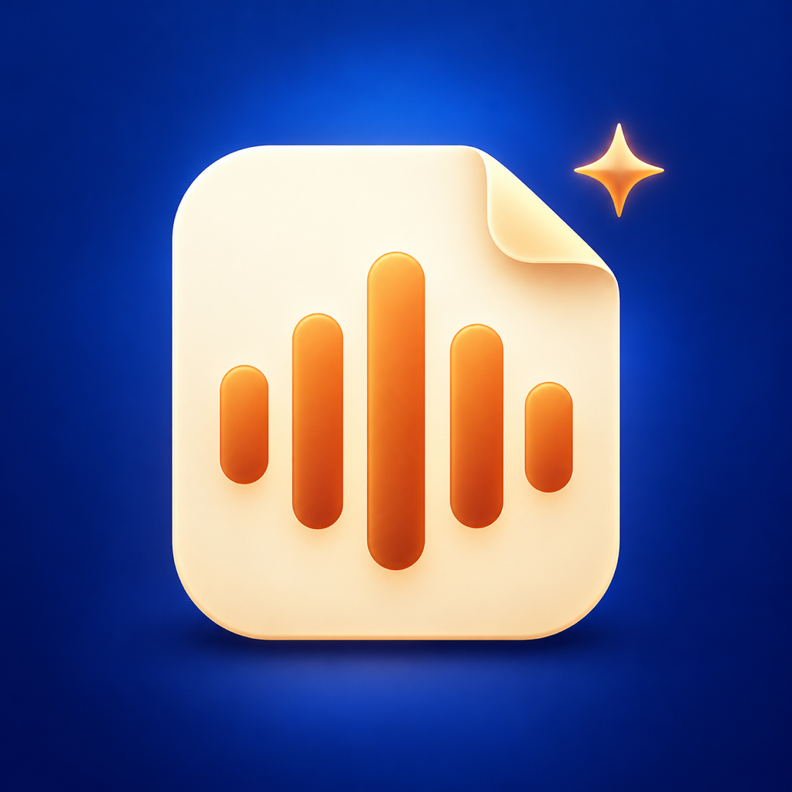

# 工作记忆 · iPhone 独立版



手机可以独立录音、转文字、提炼重点、整理选题；日常使用不需要 Mac。Mac 目前只用于开发、安装和重新签名。

**源码按 MIT 许可证免费开放。AI 服务不包含在项目里：请使用自己的 API 凭证和额度，费用直接付给服务商。**本项目不收取 API 费用，不提供共享密钥或免费 AI 账户。

## 下载后怎么用

- **让 Codex 帮你装：**下载仓库并在 Codex 中打开，复制 [这份安装指令](docs/CODEX_QUICKSTART.md)。它会引导你使用自己的 Apple 账户、安装到自己的 iPhone。
- **自己用 Xcode 装：**按 [中文安装教程](docs/INSTALL.md) 操作。需要 Mac、Xcode 和 iOS 17+ 的 iPhone。
- **先不配置 API：**仍可本地录音、回听和导出；需要 AI 时再在手机里填写自己的凭证。

```sh
git clone https://github.com/calebx10/work-memory-ios.git
cd work-memory-ios
open app/ios/WorkMemory.xcodeproj
```

这是早期个人项目，尚未完成所有真机验收；当前没有 App Store/TestFlight 下载链接。GitHub 开源不免除苹果签名限制，免费个人签名通常每 7 天需要重新安装。请先用短录音测试并备份重要内容，实际验证记录见 [测试计划](docs/TEST_PLAN.md)。

## 使用方法

1. 打开“工作记忆”，阅读首次隐私说明。
2. 在“录音”页点击麦克风，选择场景后开始；可以暂停、继续和结束。
3. 结束后先保存在手机，可以离线回听和导出。
4. 第一次分析：在“设置 → AI 服务”选择“APIMart 转写 + DeepSeek 提炼”，分别填写两家凭证后保存。也可选择只用 APIMart。App 没有附送服务账户或额度，聊天软件会员不等于 API 服务。
5. 在录音详情打开“文字与重点分析”，点击“发送并分析”，核对接收服务并确认。保持 App 在前台等待。
6. 查看“重点 / 原文 / 选题”，点原文依据可回听对应分段。结果可编辑，重点可收藏，选题可生成口播稿。
7. 搜索录音库可查找标题、标签、原文和分析。素材库汇总选题和收藏重点。

只有确认发送后才会连接 AI 服务。音频、原文或修订文字会发送给指定服务商，可能产生按量费用，对方的数据处理和保留由其政策决定。默认接口为 OpenAI 格式；其他服务必须兼容 `audio/transcriptions` 和 `chat/completions`，不是任意聊天软件账号都能直接连接。

组合配置：音频仅发至 `api.apimart.ai`（`whisper-1`），文字和选题发至 `api.deepseek.com`（`deepseek-flash`）。两家凭证按地址独立存入钥匙串，不交叉发送。DeepSeek 默认关闭深度思考、单次输出限制 8192 tokens。成功转写和分析批次会缓存；没有自动循环重试。价格、预算和本机转写候选方案见 [服务与费用](docs/AI_SERVICES.md)。

## 手机安装

工程：`app/ios/WorkMemory.xcodeproj`，Scheme：WorkMemory，iOS 17+。

使用 Xcode 登录个人 Apple 账户，选择自己的 Personal Team，连接并信任 iPhone，按系统要求开启开发者模式，再运行。免费个人签名有到期和设备限制；到期后需重新签名安装，**不要卸载 App 来更新**，卸载会删除本地数据。当前安装包的实际到期时间可查看签名配置中的 ExpirationDate，不承诺永久有效。

本仓库不包含 Apple 账户密码、证书私钥、AI 凭证或服务端。密钥通过手机安全输入框填写并保存在 Keychain；不同服务地址使用不同条目，不写入源码、普通设置或导出文件。

## 开发与测试

无第三方 Swift 包依赖。Swift Package 用于在 Mac 上测试核心逻辑：

```sh
swift test
python3 scripts/generate_project.py
xcodebuild -project app/ios/WorkMemory.xcodeproj -scheme WorkMemory -destination 'generic/platform=iOS Simulator' CODE_SIGNING_ALLOWED=NO build
xcodebuild -project app/ios/WorkMemory.xcodeproj -scheme WorkMemory -destination 'platform=iOS Simulator,name=iPhone Duo' -parallel-testing-enabled NO CODE_SIGNING_ALLOWED=NO test
```

`generate_project.py` 将个人签名保留在被 Git 忽略的 `app/ios/WorkMemory/Signing.local.xcconfig`。首次配置可以使用 `--team-id` 和 `--bundle-id` 参数，具体见 [安装教程](docs/INSTALL.md)。共享项目不包含原作者的签名身份。

UI 测试使用 Debug 专属的 `--ui-testing` 参数、独立测试目录和合成音频/模拟 AI；不读取真实录音、不调用外部服务、不收费。Release 不包含模拟 AI。测试数据不会出现在正常启动的 App 中。

## 已知边界

- 实际锁屏长录音、电话中断、耳机路由和耗电需要 iPhone 真机验收；工程编译不能替代这些测试。
- 录音采用 AAC M4A，5/10/15 分钟切段；暂停/中断也会关闭分段。切段可能有短暂间隙。异常结束时，尚未封装的末段可能不可恢复，早前完成的分段独立保存。
- 在线 AI 需要真实兼容服务、可用网络和账户额度；未配置凭证不影响本地录音。默认语音模型 `gpt-transcribe`，文字模型 `gpt-4.1-mini`；后续可在设置中调整。
- 普通转写返回没有精确句级时间戳，来源播放定位到分段起点，不伪造逐句时间。
- AI 在前台处理；切后台会取消当前操作，已保存成功步骤保留。失败后需手动重试；请求已经到达服务端但本地未收到结果时，不能保证重试不重复计费。
- 重新生成分析会替换编辑结果和选题初稿，请先导出备份。原始 AI 分析保留在本地文档的 originalAnalysis 中。
- 默认不自动删除文件，不做 Mac 同步。删除手机数据不删除已导出副本或服务商留存。

需求变更见 `docs/PRD.md`；最初含 Mac 依赖的需求保留在 `docs/ORIGINAL_PRD.md`。架构和验收步骤分别见 `docs/ARCHITECTURE.md` 与 `docs/TEST_PLAN.md`。

## 接口依据

- [Apple AVAudioRecorder](https://developer.apple.com/documentation/avfaudio/avaudiorecorder)
- [Apple AVAudioSession](https://developer.apple.com/documentation/avfaudio/avaudiosession)
- [OpenAI 文件转写](https://developers.openai.com/api/docs/guides/speech-to-text)
- [OpenAI 结构化输出](https://developers.openai.com/api/docs/guides/structured-outputs?api-mode=chat)
- [APIMart 音频转写](https://docs.apimart.ai/en/api-reference/audios/whisper-1)
- [DeepSeek 接口](https://api-docs.deepseek.com/)

## 开源许可与贡献

采用 [MIT 许可证](LICENSE)，允许使用、修改、分发及商业使用，需保留版权与许可声明。开源授权不包含 Apple 开发者账户、证书、API 服务或服务商商标的授权，也不保证 AI 服务永久免费或永久可用。

当前 Swift 工程没有第三方包依赖；没有直接合并或复制 WalkWrite、Meet2Notes 的实现。它们是早期产品研究参考。App 图标使用 AI 生成，来源和提示词见 [设计记录](docs/design/APP_ICON.md)。

欢迎按 [贡献指南](CONTRIBUTING.md) 提交改进，隐私与漏洞处理见 [安全说明](SECURITY.md)。
